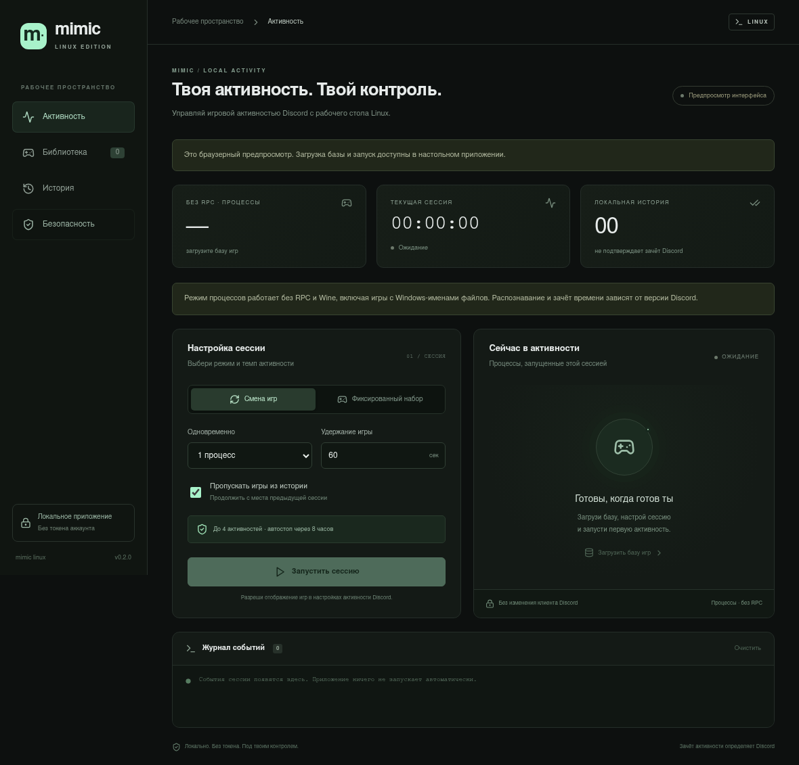

# Mimic Discord Linux

Linux-форк [Timon2306/mimic-discord](https://github.com/Timon2306/mimic-discord), с новым русским интерфейсом и переработанной логикой запуска. Основа: upstream `58413fe` (v1.3.1). MIT; оригинальное уведомление об авторских правах сохранено в LICENSE.

## Что нового в 0.2.0

Процессный режим больше не ограничен восемью записями с меткой `linux`. В текущем каталоге он предлагает **10 463 кандидата без RPC и Wine**: собственный Linux-помощник получает имя и путь из Linux- либо Windows-правила Discord. Приоритет остаётся у Linux-правила. Восемь Linux-меток не оказались общим пределом распознавания; прежний вывод версии 0.1.0 исправлен.

На штатном Linux-детекторе Discord 1.0.168 подтверждено сопоставление четырёх безоконных ELF-помощников с правильными ID игр: Factorio, Overwatch, ELDEN RING и Rocket League. Это отдельный тест детектора, **не подтверждение серверного зачёта часов или значков**. Все 10 463 позиции по отдельности не проверены. [Методика и результаты](docs/native-detection.md).

После обновления закройте старую версию, запустите новую и нажмите «Загрузить базу игр». Старый кеш восьми игр автоматически считается устаревшим. RPC включать не нужно.



## Быстрый запуск

Сначала установите системные зависимости из раздела «Сборка из исходников», затем:

```sh
git clone https://github.com/japNslow/mimic-discord-linux.git
cd mimic-discord-linux
npm ci --ignore-scripts
npm run linux:portable
./run.sh
```

Запускайте обычным пользователем, **без sudo**. Собранный файл находится в `src-tauri/target/release/mimic-linux`. Это динамически связанный Linux ELF; ему нужны GTK 3 и WebKitGTK 4.1. Сборка на одном дистрибутиве не гарантирует работу на другом. Проверить библиотеки: `ldd src-tauri/target/release/mimic-linux`.

Для локального архива с бинарником и исходниками: `npm run linux:package`. После распаковки архива готовой сборки запускайте `./mimic-linux` или `./run.sh`. Готовые файлы сборки не хранятся в Git.

1. Откройте Discord Desktop, войдите в него обычным способом.
2. В Discord разрешите отображение игровой активности.
3. В Mimic нажмите **«Загрузить базу игр»**. Автоматических запросов к базе нет.
4. Для последовательной смены оставьте **«Смена игр»**, задайте интервал и нажмите **«Запустить сессию»**.
5. Для фиксированного набора выберите до четырёх игр в **«Библиотеке»**, затем **«Перейти к сессии»**.
6. **«Остановить»** и обычное закрытие окна завершают собственные процессы приложения.

Пауза приостанавливает таймер и смену игр; уже запущенная активность остаётся до остановки. Максимум — четыре помощника/соединения и восемь часов на сессию, включая время на паузе. Фиксированный набор по умолчанию работает один час.

## Что умеет

- Linux-процессы с Linux- и Windows-именами из публичного каталога Discord; запускается только встроенный спящий ELF-помощник, а не Windows-программа.
- Последовательная смена игр либо фиксированный набор, журнал и таймер.
- Локальная история полностью выдержанных интервалов; пропуск истории при следующем запуске, JSON-импорт и экспорт.
- Отдельно включаемый экспериментальный Discord IPC/RPC для приложений без Linux-файла.
- Кеш базы на 12 часов. При сетевой ошибке можно использовать проверенный сохранённый кеш.

Число кандидатов определяется текущим каталогом Discord. Правила лаунчеров, небезопасные пути и правила с обязательными аргументами не используются для процессов. Клиент Discord должен видеть процессы помощников; контейнерные сборки могут ограничивать эту возможность. Discord в браузере не имеет нужного локального IPC. Для Discord Flatpak ищем IPC также в `$XDG_RUNTIME_DIR/app/com.discordapp.Discord/`; доступ зависит от настроек контейнера, которые приложение само не меняет. Символические ссылки на IPC намеренно не принимаются.

**История означает только локальное выполнение интервала.** Она не доказывает, что Discord показал игру или начислил часы/значки. RPC ACK подтверждает принятие команды, а не зачёт наград. Несколько RPC-соединений не гарантируют несколько одновременных видимых игр. Имитация активности — сторонний сценарий; гарантировать отсутствие санкций аккаунту невозможно.

## Что изменено ради защиты

- Запрет запуска от root, блокировка второго экземпляра.
- Никаких токенов, паролей, self-bot, модификации клиента или внедрения в память Discord.
- Проверка путей и идентификаторов из сети **и кеша**, лимиты входных данных.
- Случайные рабочие каталоги с правами `0700` внутри отдельной папки пользователя. Файлы истории и кеша `0600`; атомарная запись, отказ от небезопасных файлов/символических ссылок.
- Собственные `Child`-дескрипторы, `kill + wait`, без остановки по сохранённым PID. Parent-death signal и `no_new_privs` для помощников; очищенное окружение.
- Проверка владельца Unix-сокета и UID собеседника, строгий READY/ACK, лимиты кадров и тайм-ауты RPC.
- Публичный каталог с CDN Discord по HTTPS, с тайм-аутами и лимитом 32 МБ, без редиректов и автоматических повторов на 429.
- Веб-интерфейс без внешних шрифтов, аналитики, CDN и сетевых разрешений. Включён CSP; доступ к событиям ограничен подпиской/отпиской.
- Нет автозапуска, фонового сервиса, автообновления или автоматической публикации релизов.

Подробности и оставшиеся ограничения: [SECURITY.md](SECURITY.md). Результаты разбора исходника: [AUDIT.md](AUDIT.md).

## Данные

Папка: `$XDG_STATE_HOME/mimic-linux`, либо `$HOME/.local/state/mimic-linux`:

- `games.json` — проверенный кеш базы;
- `history.json` — идентификаторы локально обработанных игр;
- `instance.lock` — блокировка экземпляра;
- `session-*` — временные каталоги с встроенными помощниками.

Старую папку upstream `~/.config/mimic` не читаем и не меняем. Для переноса используйте JSON-экспорт и импорт. Журнал остаётся в памяти. Интерфейс не сохраняет настройки между перезапусками, поэтому RPC каждый раз выключен.

При штатной остановке рабочие каталоги удаляются. После SIGKILL/сбоя питания они могут остаться, но дочерние процессы завершаются при смерти родителя. Автоматически сканировать и удалять старые каталоги приложение не пытается. При необходимости удалите только `session-*` в папке Mimic после остановки приложения. Не меняйте каталог данных и его предков во время работы.

## Сборка из исходников

Нужны Node.js 22+ с npm, стабильный Rust, GTK 3 и WebKitGTK 4.1.

Ubuntu/Debian (названия пакетов зависят от выпуска):

```sh
sudo apt install build-essential pkg-config libgtk-3-dev libwebkit2gtk-4.1-dev librsvg2-dev patchelf
```

Arch Linux:

```sh
sudo pacman -S --needed base-devel rust nodejs npm webkit2gtk-4.1 gtk3 librsvg
```

В каталоге проекта:

```sh
npm ci --ignore-scripts
npm run check
npm run linux:portable
```

Результат: `src-tauri/target/release/mimic-linux`. Для разработки: `npm run tauri dev`. Только веб-предпросмотр: `npm run dev` (запуск процессов в нём отключён).

Установочный `.deb` можно собрать командой `npm run linux:build`. Для совместимости с Ubuntu собирайте пакет на Ubuntu: сборка на Arch не обеспечивает совместимость со старыми glibc/WebKitGTK. Workflow CI настроен собирать Linux-бинарник и `.deb` на Ubuntu 22.04 и сохраняет их как артефакты, без публикации релиза. AppImage — опциональная сборка через `npm run tauri -- build --bundles appimage`, требующая инструментов упаковки.

Проверка интерфейса (при работающем `npm run dev` и установленном Playwright):

```sh
node tests/ui.mjs
```

Опциональные `PLAYWRIGHT_MODULE` и `CHROMIUM_PATH` позволяют использовать уже установленный тестовый браузер. Веб-проверка не подключается к аккаунту Discord.

## Проверки

Локальная проверка версии 0.2.0 выполнена на Arch Linux x86_64.

- Production-сборка TypeScript/Vite.
- Реальный публичный каталог Discord: 25 187 валидных записей, из них 10 463 процессных кандидата (снимок 8 ноября 2026; одна запись отфильтрована). Опциональный тест `downloaded_public_catalog` запускается отдельно через `MIMIC_CATALOG_FIXTURE`.
- 24 обычных теста Rust и отдельный тест скачанного каталога: Windows-имена, приоритет Linux, фильтрация аргументов и лаунчеров, сброс старого кеша, права/ссылки, блокировка экземпляра, лимиты, RPC и очистка собственных helpers.
- Штатный детектор Discord распознал четыре Windows-имени на Linux с правильными ID: [машинный результат](docs/native-detection-results.json). В приложении модуль Discord не используется, не копируется и не меняется.
- Интерфейс: навигация, пустые состояния, переключение RPC, отсутствие внешних запросов, размеры окна 1180/860/650/390 px.
- Нативный запуск, отказ второму экземпляру и завершение helper при SIGKILL родителя.
- `cargo clippy --all-targets -- -D warnings`: без замечаний.
- `npm audit`: известных уязвимостей не обнаружено на момент проверки.

Реальный серверный зачёт часов и наград Discord не проверен; отображаемый таймер сам по себе не является таким подтверждением. Это не независимый аудит безопасности и не обещание абсолютной защиты.
